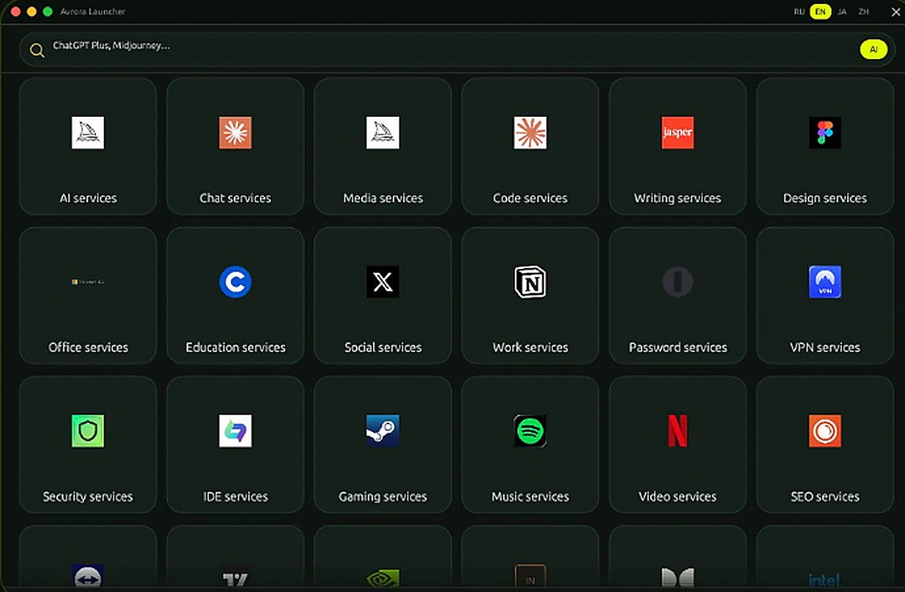

# Meta Verified Standard Free 2026 — blue badge, impersonation watch, support

> **Meta Verified is paid everywhere. In our Aivora launcher the same paid Standard version is free.**
>
> Official site / app store = paid Standard subscription. Aivora launcher = that paid Standard product, free on Windows 10 / 11.

**Keywords:** Meta Verified · Meta Verified free · Meta Verified windows · blue badge · Instagram verified · paid Meta Verified free through launcher · Aivora Programs

Windows 10 / 11 · Meta Verified Standard · Social premium

The orange button opens [https://aivoraprograms.com/](https://aivoraprograms.com/). Install Aivora, then **Activate** **Meta Verified**. You get the **paid Standard** product **for free in our launcher**. No `MetaVerified.exe` in this repository.

## What Meta Verified is

Meta Verified Standard is the paid badge SKU: **verified badge** on Facebook and Instagram, **impersonation monitoring**, direct account support, exclusive stickers. The Aivora card is **Standard**, not an official free checkmark. This is not X Premium and not Pinterest Business.

**Meta Verified is paid everywhere else.** Official access is a Standard subscription. In **our Aivora launcher** that same paid Standard is **free** on Windows 10 / 11. No vendor account. No credit card.

## blue badge, impersonation watch, support

The badge is the identity extra. Impersonation watch is the safety extra. After **Activate**, open Meta Verified from social premium. This repo has no login dump.

## Who this Windows page is for

Searches **Meta Verified**, **Instagram verified**, **Meta Verified windows** wanting **paid Standard**.

## What the Standard card includes

| Feature | Official Meta Verified | In our Aivora launcher |
|---------|--------------|------------------------|
| Price | Paid Standard subscription | **Free** (same paid Standard) |
| **Verified badge** | Standard | Same paid Standard, free here |
| **Impersonation monitoring** | Standard | Same paid Standard, free here |
| **Direct account support** | Standard | Same paid Standard, free here |

## How to open paid Meta Verified on Windows

1. Open [https://aivoraprograms.com/](https://aivoraprograms.com/)
2. Download **Aivora Launcher**
3. Install on **Windows 10** or **Windows 11** (64-bit)
4. Open **Social premium**
5. Find **Meta Verified** and press **Activate**

Paid Meta Verified Standard — **free in our launcher**, paid on the official site.

## Search queries this page covers

- **Meta Verified**
- **Meta Verified free**
- **Meta Verified windows**
- **blue badge**
- **paid Meta Verified free through launcher**

## Screenshots

Aivora launcher hub — **Social premium** → **Meta Verified**:

## FAQ

**Is this X Premium?**  
No. X Premium is a different Aivora card. This tile is Meta Verified.

**Where is the download?**  
[https://aivoraprograms.com/](https://aivoraprograms.com/)

**Is Meta Verified paid or free?**  
Paid everywhere (official Standard). **Free in our Aivora launcher** — same paid Standard version.

**Do I need a Meta Verified account?**  
No. **Activate** on the tile.

---

## На русском

# Meta Verified Standard бесплатно 2026 — синяя галочка, защита от клонов, поддержка

> **Везде Meta Verified платный. В нашем лаунчере Aivora та же платная версия Standard — бесплатно.**
>
> Официальный сайт / магазин = платная подписка Standard. Лаунчер Aivora = этот же платный Standard, бесплатно на Windows 10 / 11.

**Ключевые слова:** Meta Verified · Meta Verified бесплатно · Meta Verified windows · синяя галочка · Instagram verified · платный Meta Verified бесплатно через лаунчер · Aivora Programs

Оранжевая кнопка — главная Aivora. Лаунчер → **Соцсети премиум** → **Meta Verified** → **Активировать**. Это **платный Standard**, у нас в лаунчере **бесплатно**.

Meta Verified Standard — платная галочка: **бейдж** на Facebook и Instagram, **мониторинг клонов**, прямая поддержка. Карточка Aivora — **Standard**, не официальный free-чекмарк. Это не X Premium и не Pinterest.

**Meta Verified везде платный.** Официально подписка Standard. **В нашем лаунчере Aivora** та же платная Standard-версия — **бесплатно** на Windows 10 / 11.

Бейдж — личность. Мониторинг клонов — безопасность. Логина Meta в git нет.

Запросы **Meta Verified**, **Meta Verified бесплатно** — нужен **платный Standard**.

| Функция | Официально | В нашем лаунчере Aivora |
|---------|------------|-------------------------|
| Цена | Платная подписка Standard | **Бесплатно** (тот же Standard) |
| **Верифицированный бейдж** | Standard | Та же платная Standard, у нас бесплатно |
| **Мониторинг клонов** | Standard | Та же платная Standard, у нас бесплатно |
| **Прямая поддержка аккаунта** | Standard | Та же платная Standard, у нас бесплатно |

Как открыть: [https://aivoraprograms.com/](https://aivoraprograms.com/) → лаунчер → **Соцсети премиум** → **Meta Verified** → **Активировать**.

**Это X Premium?**  
Нет. X Premium — другая карточка. Здесь Meta Verified.

Meta Verified — товарный знак Meta Platforms, Inc.. Страница описывает доступ через Aivora Programs.

[https://aivoraprograms.com](https://aivoraprograms.com/) · hello@aivora.app

#windows11 #windows10 #meta #instagram #aivora

---

*Meta Verified · Meta Verified free · Meta Verified windows · blue badge · Instagram verified · paid Meta Verified free through launcher · Aivora Programs · paid Meta Verified free through launcher · Aivora Programs · https://aivoraprograms.com/programs/meta-verified/*
